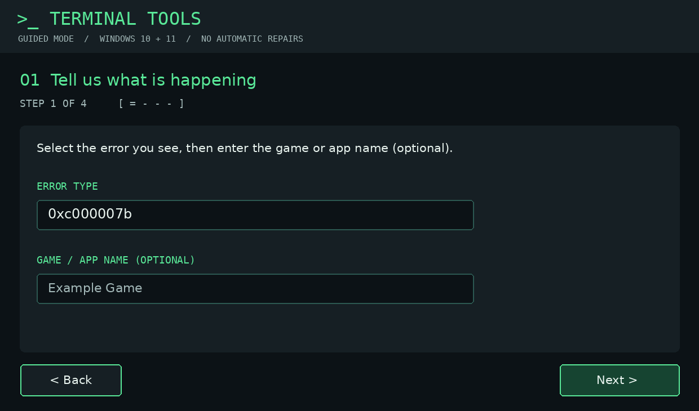
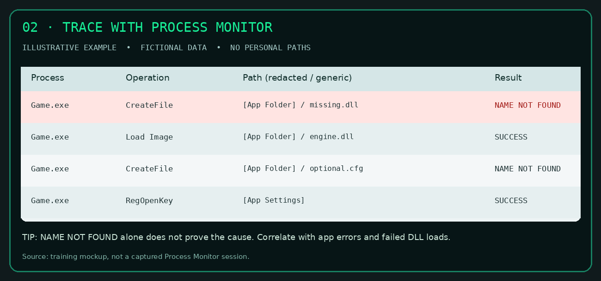
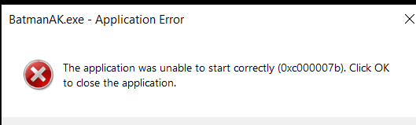
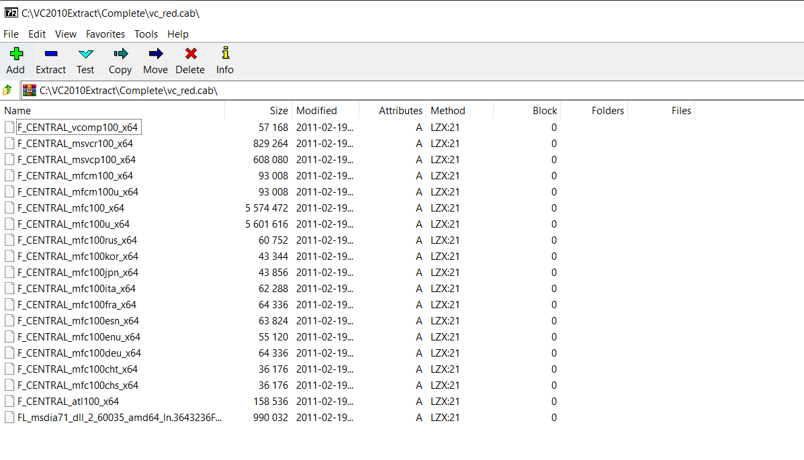
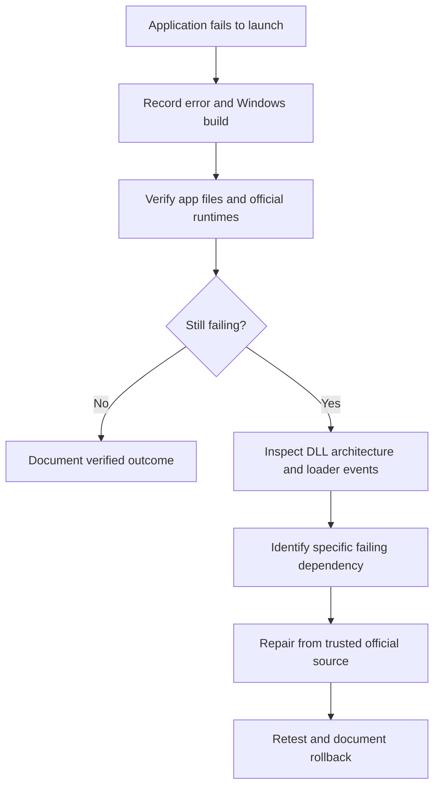

# Terminal Troubleshooter — EXE + BAT + HTML

## Launch options

| File | Behavior |
|---|---|
| **`Troubleshooter.exe`** | **Windows 64-bit EXE launcher** that opens the modern six-step HTML GUI in a dedicated **Microsoft Edge app-style window**. If Edge cannot start, it falls back to the default browser. |
| **`Launch-Troubleshooter.bat`** | Preserved: launches the four-step Windows Forms PowerShell GUI. |
| **`Troubleshooter.html`** | Preserved: opens the six-step HTML GUI directly in your browser. |

The EXE is a real Windows x64 PE executable, but **it is a launcher**, not a bundled browser engine or self-contained app. It requires the local `Troubleshooter.html` file beside it and Microsoft Edge for the standalone app-style window. Edge is normally available on Windows 10/11. Keep the whole extracted folder together. No admin rights are required for the EXE launcher.

## Screenshot previews





Both images are illustrative, not live captures. The Process Monitor table contains fictional data with no personal Windows directories.

## Security and limitations

- The EXE launches the local HTML page only. It does not download or install software, change the registry, or alter DLLs.
- The HTML interface guides the user through real manual troubleshooting steps and produces a report, but cannot inspect Windows DLLs automatically due to browser sandbox restrictions.
- The BAT's PowerShell policy override applies only to its child process.
- **Build validation:** EXE was cross-compiled and verified as Windows PE32+ x64 GUI. It has **not** been executed on Windows in this environment.

## EXE source

`launcher.c` is included for auditability and rebuilds. The EXE uses the Windows Shell API to launch Microsoft Edge with `--app=file:///...`, falling back to the system's default HTML handler.

---

# Terminal Tools — Windows App & Game Troubleshooter

A Windows troubleshooting toolkit with **two separate graphical interfaces**.

| Launcher | What opens |
| --- | --- |
| **`Launch-Troubleshooter.bat`** | Opens the **native Windows Forms GUI** with a Linux-terminal-inspired dark theme, using the bundled PowerShell GUI script. It does **not** open HTML. |
| **`Troubleshooter.html`** | Opens the **independent browser-based six-step wizard** directly, without BAT or PowerShell. |

> The BAT starts PowerShell with `-ExecutionPolicy Bypass` **only for the launched process**. It does not permanently change the computer's execution policy. Corporate policy may still prevent scripts from running.

## 🖥️ Application interface

**Windows Forms GUI launched by BAT** — design illustration (not an actual Windows capture):


**HTML wizard** — six guided stages: Select Problem → Trace with Process Monitor → Check Your PC → Recommended Actions → Tools & Resources → Finish.

The HTML page can be opened directly by double-clicking `Troubleshooter.html`. The browser cannot automatically inspect system DLLs or execute Windows diagnostics; the wizard provides instructions, checklists, and a downloadable report.

## 🚀 Launch

1. Extract the ZIP completely.
2. For the **Windows desktop GUI**, double-click `Launch-Troubleshooter.bat`.
3. For the **browser interface**, double-click `Troubleshooter.html`.
4. In either interface, follow the on-screen steps and use official resources only.

The Windows Forms GUI includes four steps: identify the error, run optional read-only diagnostics, read recommended actions, and open trusted resources. The HTML wizard has six steps.

## 📸 Screenshots

| Desktop GUI (illustrative) | Process Monitor example (illustrative) |
| :---: | :---: |
|  |  |

Both images above are **illustrations**, not genuine screenshots of running applications. The Process Monitor image contains fictional example rows and no personal directories.

---

## ✨ What can this project help with?

| 🧩 Error / symptom | 🔍 Where to start |
| :--- | :--- |
| **`0xc000007b`** — Invalid image format | [Check DLL architecture and loader events](docs/DIAGNOSTICS.md) |
| **`0xc0000142`** — Initialization failed | [Inspect startup dependencies](docs/DIAGNOSTICS.md) |
| **`0xc0000135`** — Missing dependency | [Identify missing runtime](docs/ERROR-CODES.md) |
| **`MSVCR*.dll` / `MSVCP*.dll`** errors | [Official VC++ packages and architecture](docs/DIAGNOSTICS.md) |
| **DirectX / `xinput1_3.dll`** errors | [Official legacy DirectX runtime](https://www.microsoft.com/en-us/download/details.aspx?id=35) |
| **App closes without a message** | [Process Monitor workflow](docs/DIAGNOSTICS.md) |

> [!IMPORTANT]
> This is a **diagnostic toolkit**, not a one-click fixer. Errors can have multiple causes; no repair is guaranteed. Never download random DLLs or replace shared Windows files without verification.

## 🚀 Quick Start

**1. Capture the error** — note the exact message, app, Windows version, and when it happens.

**2. Verify the application** — use its official launcher/installer integrity or repair option where available.

**3. Check official runtimes** — install or repair the correct Microsoft Visual C++ redistributables and legacy DirectX components when needed.

**4. Inspect DLLs** — use [Dependencies](https://github.com/lucasg/Dependencies) and [Microsoft Process Monitor](https://learn.microsoft.com/en-us/sysinternals/downloads/procmon). A `NAME NOT FOUND` lookup can be normal; a successful file open does **not** prove a DLL loaded successfully.

**5. Run the read-only architecture check** in PowerShell from the repository directory:

```powershell
powershell -NoProfile -File .\scripts\Check-VC2010Architecture.ps1
```

**6. Retest and record the outcome** — keep track of what actually worked and how to undo changes.

## 📸 Screenshots

New fictional Process Monitor training example with generic paths and no personal directory details, alongside diagnostic screenshots. These images do **not** prove the game was fixed.

<table>
<tr><td align="center"><b>01 · The launch error</b></td><td align="center"><b>02 · Trace with Process Monitor</b></td></tr>
<tr><td></td><td></td></tr>
<tr><td colspan="2" align="center"><b>03 · Inspect official runtime files using 7-Zip</b></td></tr>
<tr><td colspan="2" align="center"></td></tr>
</table>

## 🧭 Diagnostic flow



## 📚 Documentation

| Guide | What you will learn |
| :--- | :--- |
| [🔎 Diagnostics](docs/DIAGNOSTICS.md) | Dependencies, Process Monitor, Windows logs |
| [📦 Runtime extraction](docs/EXTRACTION.md) | Inspect official VC++ installer files safely |
| [↩️ Rollback](docs/ROLLBACK.md) | Undo app-local changes and recover safely |
| [🧾 Error code reference](docs/ERROR-CODES.md) | Common startup codes and next steps |
| [🎮 Batman: Arkham Knight case study](docs/BATMAN-ARKHAM-KNIGHT-CASE-STUDY.md) | Actual evidence from a `0xc000007b` investigation |
| [🤝 Contributing](CONTRIBUTING.md) | Report and document reproducible fixes |

## 🧪 Real-world case study

In one **Windows 10 Pro x64** investigation, two VC++ 2010 DLLs had unexpected architectures:

| File | Detected | Expected on 64-bit Windows |
| :--- | :---: | :---: |
| `System32\msvcr100.dll` | ❌ x86 | x64 |
| `System32\msvcp100.dll` | ✅ x64 | x64 |
| `SysWOW64\msvcr100.dll` | ✅ x86 | x86 |
| `SysWOW64\msvcp100.dll` | ❌ x64 | x86 |

A Microsoft-signed x64 `msvcr100.dll` was successfully extracted and verified. **The final game launch outcome is not yet confirmed**, so this remains a documented investigation, **not** a verified universal fix. [Read the case study →](docs/BATMAN-ARKHAM-KNIGHT-CASE-STUDY.md)

## 🛡️ Safety first

- Use only trusted official runtime installers; do not redistribute Microsoft DLLs or game binaries in this repository.
- Do not modify `System32` or `SysWOW64` manually as a routine fix.
- Before app-local DLL tests, check for an existing file and preserve a rollback path.
- Redact usernames, personal paths, serial numbers, and private data from screenshots and logs.
- Only label a solution **verified** after a successful retest.

## 🤝 Contributing

Found another reproducible startup issue? Open an issue using the [bug report template](.github/ISSUE_TEMPLATE/bug_report.md) and include the error, Windows build, diagnostic evidence, and verified outcome.

---

<div align="center">

**Made for people who want to understand the failure—not just try random fixes.**

MIT-licensed original documentation and scripts · Unofficial community project · Not affiliated with Microsoft or game publishers.

</div>


> **Screenshot privacy:** The Process Monitor illustration omits file and Windows directory paths. It is a visual guide, not an actual captured trace.


## Linux-inspired GUI launcher (Windows)

Double-click **`Launch-Troubleshooter.bat`** to launch the dark, terminal-inspired Windows Forms interface. The launcher uses `powershell.exe -NoProfile -ExecutionPolicy Bypass -STA -File` so the scripts can run **only in that process** without permanently changing your Windows execution policy. It does not require administrator rights. If organizational security policy blocks PowerShell, ask your administrator instead of bypassing it.

The three GUI tabs provide official publisher links, read-only diagnostics, and local documentation. **This is a Windows application with a Linux-inspired appearance, not a native Linux executable.**


### Fixed in this release

The wizard keeps Windows Forms controls in script scope, so the **Check Windows**, **Check VC++ 2010 DLLs**, and **Copy results** button handlers can update the diagnostics output without a `PropertyNotFound` error. The same scope fix applies to the issue selector and app-name field.
