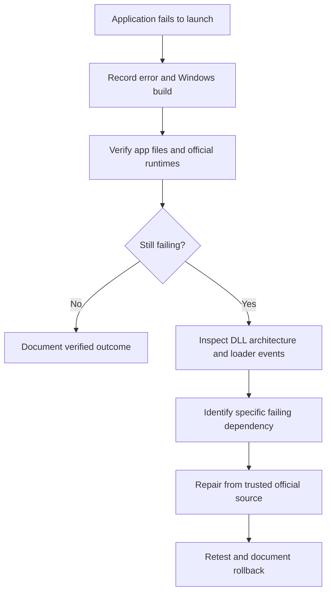

## Guided troubleshooting (new)

Open **`Launch-Troubleshooter.bat`** and follow the **four-step wizard**:

1. **Describe the problem:** Choose an error code and optionally enter the game/app name.
2. **Check your PC:** Run optional read-only Windows or Visual C++ 2010 checks and copy the results.
3. **Follow tailored advice:** Read steps specific to the selected error, without automatic changes.
4. **Open trusted resources:** Official Microsoft and developer download pages; copy a summary to share with support.

Use **Back** and **Next** to move between steps, or **Start again** to reset. The interface is Windows-only, with a Linux-terminal-inspired dark appearance. It does not install or replace files, modify system settings, or guarantee a fix.

<div align="center">

# 🛠️ Windows App & Game Troubleshooter

### Diagnose launch errors. Inspect dependencies. Fix safely.

**A practical, open-source troubleshooting guide for Windows games and desktop applications.**

   

[**🚀 Quick Start**](#-quick-start) · [**📸 Screenshots**](#-screenshots) · [**📚 Guides**](#-documentation) · [**🧪 Case Study**](#-real-world-case-study)

</div>

---

## ✨ What can this project help with?

| 🧩 Error / symptom | 🔍 Where to start |
| :--- | :--- |
| **`0xc000007b`** — Invalid image format | [Check DLL architecture and loader events](docs/DIAGNOSTICS.md) |
| **`0xc0000142`** — Initialization failed | [Inspect startup dependencies](docs/DIAGNOSTICS.md) |
| **`0xc0000135`** — Missing dependency | [Identify missing runtime](docs/ERROR-CODES.md) |
| **`MSVCR*.dll` / `MSVCP*.dll`** errors | [Official VC++ packages and architecture](docs/DIAGNOSTICS.md) |
| **DirectX / `xinput1_3.dll`** errors | [Official legacy DirectX runtime](https://www.microsoft.com/en-us/download/details.aspx?id=35) |
| **App closes without a message** | [Process Monitor workflow](docs/DIAGNOSTICS.md) |

> [!IMPORTANT]
> This is a **diagnostic toolkit**, not a one-click fixer. Errors can have multiple causes; no repair is guaranteed. Never download random DLLs or replace shared Windows files without verification.

## 🖥️ Windows GUI Launcher

Double-click **`Launch-Troubleshooter.bat`** to open the desktop graphical interface (Windows 10/11, Windows PowerShell 5.1). The BAT launches `scripts/Troubleshooter-GUI.ps1`.

- **Official downloads:** Microsoft Visual C++, DirectX, Sysinternals Process Monitor, Dependencies, and 7-Zip links.
- **Read-only diagnostics:** inspect Visual C++ 2010 DLL architecture and Windows version; copy the output.
- **Local guides:** open the bundled diagnostic, error-code, extraction, rollback and case-study documents.

**Safety:** no silent downloads, installs, registry edits, or DLL replacement. Keep the BAT file together with the `scripts` and `docs` folders. The GUI has not yet been visually tested on Windows, so a genuine screenshot is not available yet.

## 🚀 Quick Start

**1. Capture the error** — note the exact message, app, Windows version, and when it happens.

**2. Verify the application** — use its official launcher/installer integrity or repair option where available.

**3. Check official runtimes** — install or repair the correct Microsoft Visual C++ redistributables and legacy DirectX components when needed.

**4. Inspect DLLs** — use [Dependencies](https://github.com/lucasg/Dependencies) and [Microsoft Process Monitor](https://learn.microsoft.com/en-us/sysinternals/downloads/procmon). A `NAME NOT FOUND` lookup can be normal; a successful file open does **not** prove a DLL loaded successfully.

**5. Run the read-only architecture check** in PowerShell from the repository directory:

```powershell
powershell -NoProfile -File .\scripts\Check-VC2010Architecture.ps1
```

**6. Retest and record the outcome** — keep track of what actually worked and how to undo changes.

## 📸 Screenshots

Real screenshots from a Windows 10 / Batman: Arkham Knight troubleshooting session. They illustrate the process; they do **not** prove the game was fixed.

<table>
<tr><td align="center"><b>01 · The launch error</b></td><td align="center"><b>02 · Trace with Process Monitor</b></td></tr>
<tr><td></td><td></td></tr>
<tr><td colspan="2" align="center"><b>03 · Inspect official runtime files using 7-Zip</b></td></tr>
<tr><td colspan="2" align="center"></td></tr>
</table>

## 🧭 Diagnostic flow



## 📚 Documentation

| Guide | What you will learn |
| :--- | :--- |
| [🔎 Diagnostics](docs/DIAGNOSTICS.md) | Dependencies, Process Monitor, Windows logs |
| [📦 Runtime extraction](docs/EXTRACTION.md) | Inspect official VC++ installer files safely |
| [↩️ Rollback](docs/ROLLBACK.md) | Undo app-local changes and recover safely |
| [🧾 Error code reference](docs/ERROR-CODES.md) | Common startup codes and next steps |
| [🎮 Batman: Arkham Knight case study](docs/BATMAN-ARKHAM-KNIGHT-CASE-STUDY.md) | Actual evidence from a `0xc000007b` investigation |
| [🤝 Contributing](CONTRIBUTING.md) | Report and document reproducible fixes |

## 🧪 Real-world case study

In one **Windows 10 Pro x64** investigation, two VC++ 2010 DLLs had unexpected architectures:

| File | Detected | Expected on 64-bit Windows |
| :--- | :---: | :---: |
| `System32\msvcr100.dll` | ❌ x86 | x64 |
| `System32\msvcp100.dll` | ✅ x64 | x64 |
| `SysWOW64\msvcr100.dll` | ✅ x86 | x86 |
| `SysWOW64\msvcp100.dll` | ❌ x64 | x86 |

A Microsoft-signed x64 `msvcr100.dll` was successfully extracted and verified. **The final game launch outcome is not yet confirmed**, so this remains a documented investigation, **not** a verified universal fix. [Read the case study →](docs/BATMAN-ARKHAM-KNIGHT-CASE-STUDY.md)

## 🛡️ Safety first

- Use only trusted official runtime installers; do not redistribute Microsoft DLLs or game binaries in this repository.
- Do not modify `System32` or `SysWOW64` manually as a routine fix.
- Before app-local DLL tests, check for an existing file and preserve a rollback path.
- Redact usernames, personal paths, serial numbers, and private data from screenshots and logs.
- Only label a solution **verified** after a successful retest.

## 🤝 Contributing

Found another reproducible startup issue? Open an issue using the [bug report template](.github/ISSUE_TEMPLATE/bug_report.md) and include the error, Windows build, diagnostic evidence, and verified outcome.

---

<div align="center">

**Made for people who want to understand the failure—not just try random fixes.**

MIT-licensed original documentation and scripts · Unofficial community project · Not affiliated with Microsoft or game publishers.

</div>


> **Screenshot privacy:** User-profile paths in the Process Monitor screenshot have been replaced with generic example paths. The screenshot is illustrative; refer to your own trace for exact directories.


## Linux-inspired GUI launcher (Windows)

Double-click **`Launch-Troubleshooter.bat`** to launch the dark, terminal-inspired Windows Forms interface. The launcher uses `powershell.exe -NoProfile -ExecutionPolicy Bypass -STA -File` so the scripts can run **only in that process** without permanently changing your Windows execution policy. It does not require administrator rights. If organizational security policy blocks PowerShell, ask your administrator instead of bypassing it.

The three GUI tabs provide official publisher links, read-only diagnostics, and local documentation. **This is a Windows application with a Linux-inspired appearance, not a native Linux executable.**


### Fixed in this release

The wizard keeps Windows Forms controls in script scope, so the **Check Windows**, **Check VC++ 2010 DLLs**, and **Copy results** button handlers can update the diagnostics output without a `PropertyNotFound` error. The same scope fix applies to the issue selector and app-name field.
