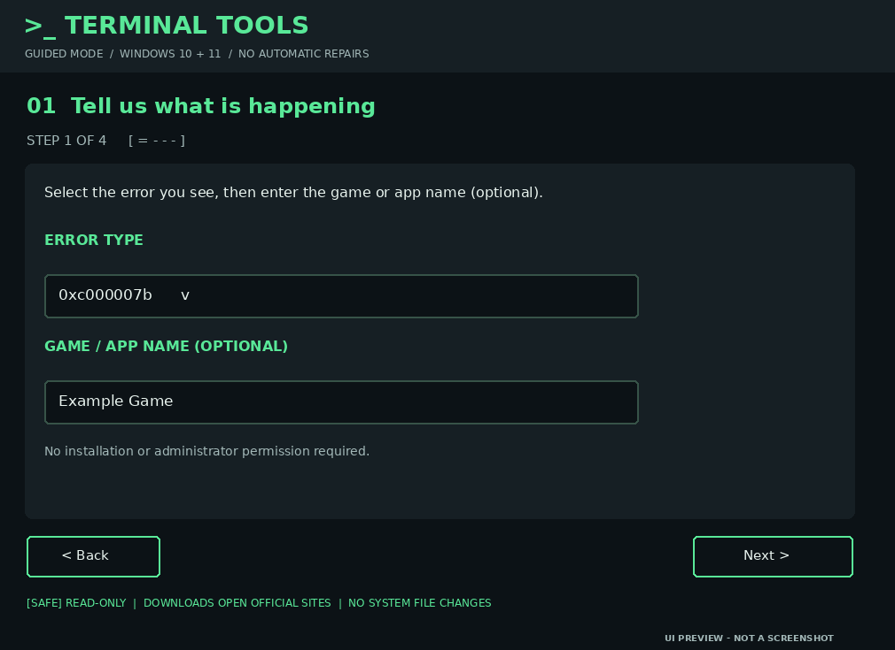
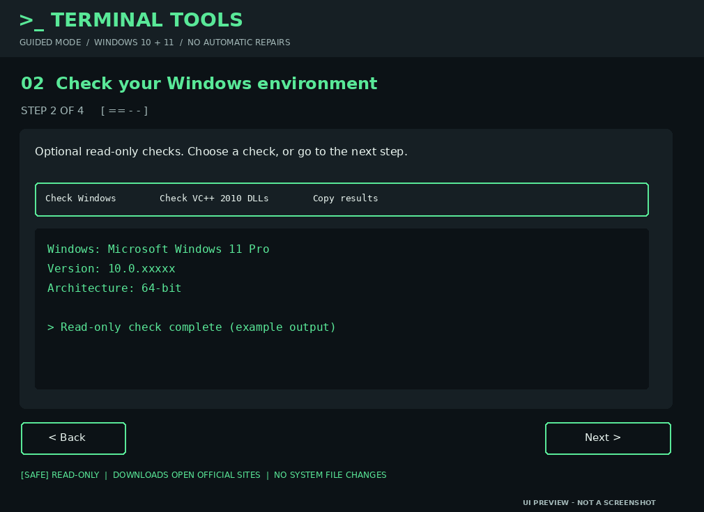
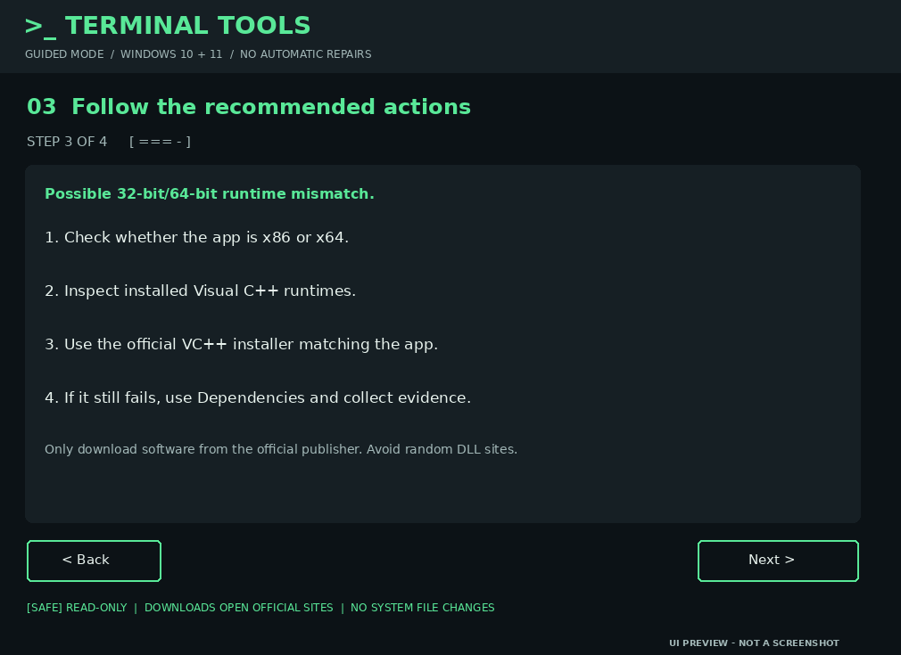
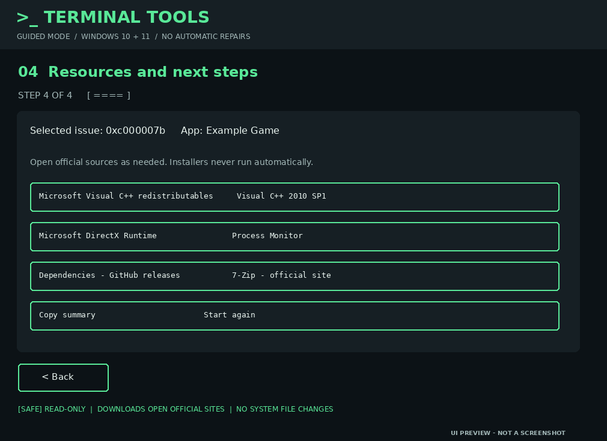

# 🟢 Terminal Tools — Windows App & Game Troubleshooter

**A guided troubleshooting toolkit for Windows applications and games.** Choose your error, follow clear diagnostic steps, inspect evidence, and export a support report. The interface uses a dark, Linux-terminal-inspired visual style.

> **Diagnostic assistant, not an automatic repair tool.** The project does not silently install runtimes, replace DLLs, or modify Windows system files.

## 🖥️ Choose how to launch

| Option | File | Experience | Requirements |
|---|---|---|---|
| **Recommended desktop** | `Troubleshooter.exe` | Opens the **six-step HTML interface** in a standalone Microsoft Edge app-style window | Windows x64 + Microsoft Edge + `Troubleshooter.html` in the same folder |
| **Legacy desktop** | `Launch-Troubleshooter.bat` | Opens the **four-step Windows Forms GUI** using the included PowerShell script | Windows PowerShell 5.1; some enterprise policies may restrict execution |
| **Browser** | `Troubleshooter.html` | Opens the **six-step interface** directly in your browser | Modern browser; no BAT or PowerShell required |

**The EXE is a Windows x64 launcher, not a self-contained browser engine.** It falls back to the default browser if Edge app mode is unavailable. Keep all files together after extracting the ZIP.

## 📸 Interface gallery

### Modern six-step interface (EXE / HTML)

The modern interface features a step sidebar, dark panels, green highlights, navigation controls, and contextual guidance. The images below are **design illustrations from the project**, not verified Windows runtime captures.

| Step 1 — Identify the issue | Step 2 — Guided diagnostics |
| :---: | :---: |
|  |  |
| Step 3 — Recommended checks | Step 4 — Resources |
|  |  |

### Legacy BAT desktop GUI

The BAT opens a **real Windows Forms window**, rather than a CMD text menu.


### Process Monitor training example


This Process Monitor illustration uses **fictional events and generic directories**. A `NAME NOT FOUND` result is not automatically proof of the failure's root cause.

## 🧭 Six-step troubleshooting workflow (EXE / HTML)

| Step | What you do | Available features |
|---|---|---|
| **01 · Select Problem** | Choose the error or symptom and enter the app/game name | Error dropdown, optional app and executable names |
| **02 · Trace with Process Monitor** | Download Process Monitor, filter by executable, reproduce the error, inspect events | Microsoft official link, capture/filter instructions, fictional results table, notes field |
| **03 · Check Your PC** | Record app architecture, review basic checks, optionally use the bundled checker | x86/x64 selector, checklist, paste diagnostics, copy PowerShell command |
| **04 · Recommended Actions** | Follow recommendations for your chosen error | Error-specific guidance and completion checkboxes |
| **05 · Tools & Resources** | Open trusted publishers' pages | Official Microsoft and developer links |
| **06 · Finish** | Review and save your findings | Summary of entered data and **Download report (.txt)** |

The HTML wizard is **interactive and works locally**, but browser security prevents it from automatically reading system DLLs or running Process Monitor.

## 🧰 Supported problems and guidance

| Error / symptom | Suggested investigation |
|---|---|
| `0xc000007b` | Check 32-bit vs 64-bit dependencies and Visual C++ runtime architecture |
| `0xc0000135` | Identify missing runtime or framework |
| `0xc0000142` | Review initialization failures, app files, and Event Viewer |
| **Missing DLL** | Identify the exact file and obtain required components from official installers |
| **Crashes on launch** | Review application logs, overlays, and dependency failures |
| **Other** | Record the exact message and collect evidence |

## 🔗 Included resources

The modern interface links to:

- [Process Monitor — Microsoft Sysinternals](https://learn.microsoft.com/en-us/sysinternals/downloads/procmon)
- [Latest supported Visual C++ redistributables — Microsoft](https://learn.microsoft.com/en-us/cpp/windows/latest-supported-vc-redist)
- [Visual C++ 2010 SP1 — Microsoft](https://www.microsoft.com/en-us/download/details.aspx?id=26999)
- [DirectX End-User Runtime — Microsoft](https://www.microsoft.com/en-us/download/details.aspx?id=35)
- [Dependencies — GitHub](https://github.com/lucasg/Dependencies/releases)
- [7-Zip — Official](https://www.7-zip.org/)

These are **links**, not bundled installers; nothing is downloaded automatically.

## 🚀 Quick start

1. Download and extract the full project ZIP.
2. Run **`Troubleshooter.exe`** for the recommended desktop-style interface, **or** open `Troubleshooter.html` directly.
3. Select an error and follow the six guided steps.
4. Record Process Monitor findings and paste optional diagnostic output.
5. Export your text report to share with support.

To use the legacy GUI instead, double-click `Launch-Troubleshooter.bat`. It runs the PowerShell GUI with a process-scoped execution-policy override, without permanently changing system settings.

## 📁 Project layout

```text
Terminal-Troubleshooter-EXE/
├── Troubleshooter.exe           # Windows x64 launcher for modern GUI
├── Troubleshooter.html          # Standalone modern six-step interface
├── Launch-Troubleshooter.bat    # Legacy Windows Forms GUI launcher
├── launcher.c                   # EXE launcher source
├── scripts/
│   ├── Troubleshooter-GUI.ps1
│   └── Check-VC2010Architecture.ps1
├── assets/
│   └── screenshots/
├── docs/
├── CONTRIBUTING.md
└── LICENSE
```

## 📚 Technical guides

- [Error codes](docs/ERROR-CODES.md)
- [Diagnostics workflow](docs/DIAGNOSTICS.md)
- [Runtime extraction](docs/EXTRACTION.md)
- [Rollback and safety](docs/ROLLBACK.md)
- [Batman: Arkham Knight investigation](docs/BATMAN-ARKHAM-KNIGHT-CASE-STUDY.md)

The Batman case study documents an observed DLL architecture problem; **a complete game fix was not verified**.

## 🔒 Privacy, security and limitations

- The HTML page does not send entered information to a server. Clicking an official resource link opens that external website.
- Screenshots in this README are illustrative and must not be presented as real Windows execution evidence.
- Avoid untrusted DLL download websites and do not manually overwrite shared Windows DLLs.
- The EXE launcher requires its adjacent HTML file. Its Windows behavior has **not been tested on an actual Windows PC** in this environment.
- The ZIP can be validated structurally, but the Windows Forms GUI and EXE need on-device testing.
- Process Monitor captures may contain personal directory paths; review and redact before sharing.

## 🤝 Contributing

See [CONTRIBUTING.md](CONTRIBUTING.md) for issue reporting and proposed changes.

## 📄 License

See [LICENSE](LICENSE).
